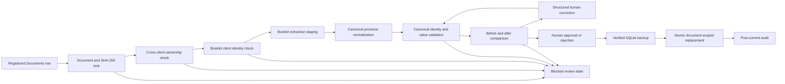

# Canonical Controlled Booklet Reprocessing V1

Status: Implemented desktop architecture standard

Applies to: Renewal Review Builder desktop WPF app only

Version: `CANONICAL_CONTROLLED_BOOKLET_REPROCESSING_V1`

## Purpose

This workflow repairs saved booklet Plan Design data one registered source document at a time without allowing extraction to overwrite live data before review. It turns the previously manual booklet-by-booklet procedure into a durable, human-approved, reversible desktop workflow.

V1 is additive. It does not create another Plan Design fact store. Approved facts continue to use the existing `PlanDesign`, `plan_design_features`, `PlanBenefitRule`, `ImportBatch`, `DocumentSource`, `ValidationIssue`, and benefit-administration tables.

## Required path

## Ownership boundaries

- `BookletExtractorRunner` remains the raw extraction boundary.
- `BookletClientIdentityGuardrail` owns the shared definition of a confirmed booklet identity and likely client-name match.
- `CanonicalControlledBookletReprocessingService` orchestrates preflight, staging, validation, comparison, approval, backup, commit, and post-commit audit.
- `DatabaseService.ControlledBookletReprocessing` owns workflow schema, source queries, run persistence, backup creation, and audit status.
- `ControlledBookletReprocessingView` is a consumer. It does not parse documents or open SQLite.
- `DatabaseService.SavePlanDesignAsync` remains the only Plan Design replacement path. Controlled calls supply the expected document id and source hash so a changed source rolls back the transaction.

## One-document contract

Each run is locked to exactly one existing `Documents` row and records:

- source document id
- owning client id and client name
- registered carrier
- canonical file path and filename
- stored SHA-256 hash
- detected document client and carrier
- identity confidence and identity source
- before and staged Plan Design snapshots
- validation issues and before/after changes
- field-level correction history, reason, user, and timestamp
- reviewer identity and timestamps
- pre-commit backup path
- post-commit row count and final status

Folder-wide or multi-client replacement is outside V1. A user may process several booklets, but each booklet must have its own staged run and approval.

## Blocking guardrails

Approval is disabled when any of these conditions is present:

- the selected row is not a registered benefit booklet
- the source file is missing
- the live file hash differs from the registered hash
- the same source hash is assigned to another client
- booklet client identity is unconfirmed or conflicts with the registered client
- extraction does not report exactly one successful source
- extraction review rows remain unresolved
- no Plan Design rows were staged
- staged row lineage cites another file
- a reimbursement value is outside 0 through 100
- multi-percentage wording remains structurally ambiguous
- a Plan Design row has no stable provision identity
- the same benefit, class, and provision identity occurs more than once
- staging contains fewer rows than the current document
- a current top-level benefit is missing from staging
- staging introduces a new canonical validation issue

A carrier-name difference is a warning when the registered client identity and source hash still pass. It remains visible to the reviewer.

Medium-confidence extraction summaries are also retained as non-blocking review recommendations. Low-confidence rows and explicit `Review required` or `Needs Review` flags remain blocking. This keeps advisory review visible without making a controlled run impossible to approve.

## Persistence

V1 adds four workflow tables:

- `ControlledBookletReprocessingRun`
- `ControlledBookletReprocessingIssue`
- `ControlledBookletReprocessingChange`
- `ControlledBookletReprocessingEdit`

These tables store operational control and audit information only. They do not duplicate canonical Plan Design facts.

## Human correction loop

A blocked or ready review may correct an existing staged provision inside the desktop app. The editable fields are reimbursement percentage, maximum, frequency, waiting period, termination age, coverage details, and notes. Client, benefit, class, provision identity, source document, source page, and source hash remain locked to their extracted lineage.

Every correction requires a reason. Saving a correction updates only the staged snapshot, writes one immutable audit row per changed field, rebuilds the before/after comparison, and reruns the same canonical value and provision guardrails. It never writes directly to `PlanDesign`.

Recurring extraction defects remain extractor-development work. A staged correction is a controlled document-specific decision, not a hidden global parser rule.

Only one active run may exist for a source document while its status is `Extracting`, `Ready for Approval`, or `Committing`.

## Approval and rollback

Approval performs the following sequence:

1. Reload and verify the run is still eligible.
2. Recheck the `Documents` owner, path, stored hash, live file hash, and cross-client assignments.
3. Create an online SQLite backup and run `PRAGMA quick_check` against it.
4. Mark the run `Committing` with reviewer and backup evidence.
5. Call the existing document-scoped Plan Design save in one transaction.
6. Require the saved document id and row count to match the approved stage.
7. Require the post-commit document to contain no out-of-range reimbursement values.
8. Mark the run `Committed` and retain the backup path.

If commit or post-commit audit fails, the run is marked `Failed` and the backup path remains the explicit rollback pointer. V1 does not automatically replace the live database with a backup.

## Compatibility

Existing immediate-save booklet and batch workflows remain available and unchanged. The controlled workflow is the official path for repairing historical booklet data and for any future booklet reprocessing where live canonical facts already exist.

The workflow appears in Document Intelligence and provides:

- registered booklet selection
- staged row counts
- before and after facts
- structured staged-value correction with a required reason
- correction count retained with the run
- blocking and warning checks
- explicit approval or rejection
- staging-folder access
- backup-folder access after commit

## Verification expectations

Focused tests must prove:

- staging does not change live Plan Design rows
- a clean approval creates a valid backup and commits only the selected document
- out-of-range percentages cannot be approved
- a staged correction reruns validation and remains outside live Plan Design until approval
- correction field history survives approval and commit
- cross-client duplicate hashes stop before extraction
- a source file changed after staging cannot be committed
- WPF remains free of parser, runner, extractor, and direct SQLite dependencies for this workflow
- both current and staged rows use the same canonical provision identity before comparison
