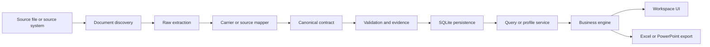
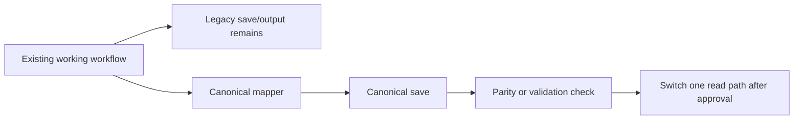

# Canonical Data Pipeline Standard

Status: Official desktop architecture standard

Applies to: Renewal Review Builder desktop WPF app only

## Purpose

All new and migrated workflows must follow one shared data path from source document to UI, calculation engine, and export. This keeps carrier-specific extraction, normalized storage, business calculations, and client-facing outputs separated.

The goal is not to rewrite working workflows at once. The goal is to move each workflow onto the same road slowly, with legacy behavior preserved until parity is proven.

## Required pipeline

Every durable workflow must follow this sequence:



No workflow should skip from raw extraction directly to UI, export, or business calculation unless it is a temporary compatibility path documented with a migration plan.

## Layer responsibilities

### 1. Document discovery

Discovers source files, classifies document types, selects the official source for a workflow, and records workflow availability.

Primary desktop anchors:

- `DocumentDiscoveryService`
- `BatchDocumentProcessorService`
- `BookletExtractorRunner`
- `ProposalEngineRunner`

Discovery code may identify inputs and route workflows. It must not contain final business calculations.

### 2. Raw extraction

Reads PDFs, Excel workbooks, booklets, OCR text, or future API payloads and produces source-shaped extracted data.

Examples:

- carrier PDF parsers
- workbook parsers
- billing statement parsers
- booklet plan design extractor
- proposal engine extractor
- flexible benefit OCR/parser

Extraction code may understand source layout, carrier wording, worksheet structure, and PDF text. It must not write final canonical tables directly.

### 3. Carrier or source mapper

Converts source-shaped extracted data into Westland's canonical language.

Mapper rules:

- Carrier-specific labels belong in mapper or terminology classes.
- Shared engines, UI, export writers, and canonical persistence must not contain carrier-specific conditionals.
- Unknown terms should be marked unavailable or needs review instead of guessed.
- Missing values should remain missing unless the source clearly supports a safe default.

Reference pattern:

- `ICarrierClaimsCanonicalMapper`
- `CarrierClaimsCanonicalMapperRegistry`
- carrier-specific claims mappers

### 4. Canonical contract

The canonical contract is the stable app-owned model for a business domain.

Canonical contracts should:

- use Westland standard names, not carrier labels
- separate facts from validation results
- include enough identity to reprocess safely
- retain confidence and source references
- avoid UI-specific fields
- avoid export-specific formatting

Recommended naming:

- `<Domain>CanonicalImportEnvelope`
- `<Domain>CanonicalFact`
- `<Domain>CanonicalEvidence`
- `<Domain>CanonicalValidation`
- `<Domain>Profile`

### 5. Validation and evidence

Every canonical import should validate required values and preserve source evidence.

Minimum evidence expectations:

- source file name
- source document id when available
- carrier or source system
- import batch id when available
- extraction method
- confidence score when available
- raw source reference
- best available location, such as page, section, worksheet, row, or cell

Validation must produce reviewable issues instead of silently filling uncertain values.

For Plan Design, `CANONICAL_SOURCE_LINEAGE_VALUE_GUARDRAILS_V1` is mandatory before a fact reaches a canonical consumer. The linked `Documents` row is authoritative for filename lineage, and reimbursement percentages must pass the canonical 0-100 check. Conflicting filenames, out-of-range values, and multi-percentage wording are review states rather than inferred facts.

`CANONICAL_LABELED_DENTAL_RATE_MAPPER_V1` is the approved source-boundary interpretation for dental pages that contain multiple reimbursement rates. It may separate values only when the booklet explicitly associates each value with a named provision or defines a local Type legend. It reuses the existing PlanDesign workbook and SQLite tables; unlabeled or conflicting values continue to the review path.

`CANONICAL_CONTROLLED_BOOKLET_REPROCESSING_V1` is the required repair path for historical booklet Plan Design data. It locks one registered source document, stages extraction without changing live facts, blocks identity and value conflicts, requires human approval, creates a verified SQLite backup, and commits through the existing document-scoped Plan Design transaction.

`CANONICAL_PROVISION_IDENTITY_V1` is the mandatory Plan Design row boundary. It assigns a stable benefit, class, and provision identity; separates explicitly labeled multi-rate provisions; removes derived duplicate rows; and ensures comparisons pair rows by identity rather than displayed value. Both direct booklet saves and controlled staging use the same mapper, validator, and existing Plan Design tables.

### 6. SQLite persistence

SQLite is the durable system of record for the desktop app.

Required persistence rules:

- Use `DatabaseService` or a focused repository owned by the persistence layer.
- Hook additive schema initialization into the central startup/database initialization path.
- Add DDL, save/upsert/delete behavior, query behavior, tests, and docs together.
- Reprocessing must be idempotent by source document or import batch where possible.
- Existing working tables must remain intact until a separate retirement decision is made.
- Do not create a second database path for a workflow that belongs in the shared desktop database.

Runtime database:

```text
%LOCALAPPDATA%\Westland\RenewalReviewBuilder\data\Benefits_Intelligence.db
```

### 7. Query or profile service

UI, exports, and engines should read through a query/profile service rather than assembling data directly from many tables.

Recommended services:

- `<Domain>CanonicalQueryService`
- `<Domain>ProfileService`
- `Client<Domain>ProfileService`

A profile service gathers saved canonical data, validation state, missing-data warnings, and source references into one clean object for downstream use.

### 8. Business engine

Business engines perform calculations and recommendations from canonical profiles.

Examples:

- `UnderwritingEngine`
- `RenewalEngine`
- `PlanDesignIntelligenceService`
- calculation services under `Services\Intelligence`

Engines should not parse source documents, open source workbooks, or run direct UI logic.

### 9. Workspace UI and exports

UI and export layers are consumers.

They may:

- ask services to run workflows
- show imported facts, warnings, and recommendations
- let users review or approve results
- export engine/query output

They must not:

- parse source documents
- write canonical tables directly
- duplicate carrier mapping logic
- duplicate business formulas already owned by an engine
- bypass query/profile services for new canonical workflows

## Standard migration pattern

Working workflows must be migrated with a compatibility-first pattern:



Required migration steps:

1. Preserve the current workflow.
2. Add a canonical mapper beside the legacy model.
3. Dual-write canonical facts after the legacy save succeeds.
4. Record validation, evidence, and parity where applicable.
5. Add focused tests for mapper behavior, persistence, idempotent reprocess, and query results.
6. Move one read consumer at a time to the canonical query/profile service.
7. Change exports only after the new source matches the old output within approved tolerances.

## Current domain adoption map

| Domain | Current status | Standard direction |
|---|---|---|
| Claims Experience | Most advanced canonical pattern | Continue extending carrier mappers, parity, evidence, and query service before switching more consumers |
| Plan Design | Canonical read-only profile V1 combines current plan, quote, validation, factor, context, and evidence data; Source Lineage and Value Guardrails V1 protects persistence and profile reads; Provision Identity V1 standardizes row shape and stable comparison identity; Controlled Booklet Reprocessing V1 provides staged, approved, backed-up historical repair; Current vs Quote is the first migrated consumer | Run the remaining historical repairs document by document, then move Proposal Intelligence and Renewal Intelligence consumers one at a time |
| Proposal Intelligence | Focused extraction persists normalized evidence to shared SQLite; `ProposalCanonicalProfile` V1 is the official read model; the pipeline overview and Proposal Intelligence Comparison workspace are migrated UI consumers; and `ProposalIntelligenceAnalysis` V1 provides factual carrier analysis | Validate the migrated workspace with real saved proposals, then design recommendation and scenario outputs separately |
| Renewal Intelligence | Versioned renewal and underwriting tables exist | Continue using shared underwriting and renewal engines as consumers of saved profiles |
| Billing | Durable billing import and dashboard exist | Add canonical billing profile before feeding renewal or audit calculations |
| Flexible Benefits | Separate extraction, normalization, review, and persistence path exists | Align naming, evidence, and query boundaries with this standard as it matures |
| Benefit Administration | Durable service/repository path exists | Keep it as a source-backed domain feeding plan design and administration views |

## Source tracking minimum

New canonical or normalized tables should include or relate to these fields whenever durable extracted data is stored:

- `source_type`
- `source_carrier`
- `source_file_name`
- `source_document_id`
- `source_api_endpoint`
- `import_batch_id`
- `imported_at`
- `imported_by`
- `confidence_score`
- `extraction_method`
- `raw_source_reference`

If a table cannot carry these fields directly, it must relate to a source/evidence table that does.

## Forbidden shortcuts

These are not allowed for new canonical workflows:

- UI code writing canonical facts directly.
- Export writers opening source PDFs or workbooks to calculate business results.
- Parser classes inserting directly into final canonical tables.
- New workflow-specific SQLite files when the data belongs in `Benefits_Intelligence.db`.
- Carrier-specific `if` statements inside shared engines or export writers.
- Replacing working legacy tables before parity is proven.
- Overwriting history rows when a dated new version is required.
- Inferring unavailable values to make a report look complete.

## Acceptance checklist

A workflow follows the canonical standard only when all of the following are true:

- The source document or source system is identified.
- Raw extraction is separate from canonical mapping.
- Carrier/source-specific terms are mapped before persistence.
- Canonical facts are validated.
- Evidence and source tracking are stored.
- Linked document identity wins over copied source metadata when they conflict.
- Numeric percentages are range checked and ambiguous multi-value wording is preserved for review.
- Plan Design rows have one stable provision identity and duplicate identities are blocked from controlled replacement.
- Reprocessing the same source is safe.
- UI reads through a query/profile service.
- Calculations live in an engine or intelligence service.
- Exports consume query/engine output.
- Legacy parity is tested before any old read path is replaced.

## Risk boundaries

High-risk areas that require extra caution:

- `DatabaseService`
- `MainWindow.xaml.cs`
- `ReviewPackBuilder`
- `ClaimsExperienceDataModelBuilder`
- `ExcelReportWriter`
- `PowerPointDeckWriter`
- `ClaimsExperiencePowerPointExporter`

Changes near these files should be small, additive, and backed by targeted regression tests.

## First enforcement target

Claims Experience is the reference implementation for the standard because it already has mapper, import, persistence, parity, and query boundaries.

Plan Design is the second domain aligned to this standard. `PlanDesignCanonicalProfileService` provides the shared read-only profile. Plan Design Intelligence and the Current vs Quote plan-design workspace now consume that profile path.

Proposal Intelligence is the third domain in progress. `ProposalCanonicalProfileService` provides the shared read-only proposal profile, `ProposalPipelineOverviewService` drives the pipeline overview, and `ProposalIntelligenceAnalysisService` provides the versioned factual comparison layer. The Proposal Intelligence Comparison workspace now consumes that analysis through `ProposalComparisonDataService` while retaining Current vs Quote as a compatibility tab. The Reports dashboard remains on its existing path until separate parity work is complete.

## Automated enforcement

`CanonicalPipelineArchitectureTests` is the first automated guardrail for this standard. It verifies that:

- this official standard remains present and continues to define every required layer
- WPF UI code-behind does not open SQLite, issue SQL writes, or call canonical persistence directly
- shared underwriting and renewal engines do not open SQLite or gain source-parser dependencies
- workbook, PowerPoint, and other export services do not open SQLite or gain source-parser dependencies
- no new parser, extractor, or runner dependency is added to WPF UI code-behind
- the canonical Plan Design profile remains present, read-only, and connected to the existing intelligence analysis
- Canonical Source Lineage and Value Guardrails V1 remains connected to per-document Plan Design persistence, validation, and the read-only canonical profile
- Canonical Controlled Booklet Reprocessing V1 remains a one-document staged workflow with identity checks, reviewable differences, explicit approval, backup evidence, and the existing Plan Design persistence path
- Canonical Provision Identity V1 remains the shared row normalizer for controlled comparison and direct Plan Design persistence, with no duplicate table family
- Current vs Quote remains a consumer of `PlanDesignCanonicalProfileService` with no direct SQLite access or mock data service
- focused carrier comparison persists through `focused_comparison_mapper.py` and the existing `sqlite_loader.py`, with no duplicate table family
- optional focused proposal booklet validation reuses the established booklet extractor and shared validator, with ambiguous values routed to review
- the canonical proposal profile remains read-only, retains proposal versions and evidence, and reuses the existing proposal table family without parser or runner dependencies
- the dedicated proposal pipeline overview consumes the canonical proposal profile through its own service and collection while executive Reports keeps its existing snapshot
- Canonical Proposal Intelligence Analysis V1 consumes only the canonical proposal profile, preserves incomplete values and evidence, and does not select a recommended carrier
- the Proposal Intelligence Comparison workspace consumes the canonical analysis through its data service, retains Current vs Quote and the existing comparison-workbook action, and does not open SQLite or select a recommended carrier

The following existing dependencies are temporary compatibility exceptions:

- `MainWindow.xaml.cs` uses `BookletExtractorRunner`
- `MainWindow.xaml.cs` uses `ProposalEngineRunner`
- `ClientBillingDashboardView.xaml.cs` uses `GroupHealthBillingStatementParser`
- `ExcelReportWriter.cs` uses the benefit-name normalization helper on `NemMaximumExtractor`
- `PowerPointDeckWriter.cs` uses the benefit-name normalization helper on `NemMaximumExtractor`

The guardrail allows these references to be reduced as workflows are migrated, but it does not allow them to increase or spread to another UI, engine, or export file. Removing these exceptions is migration work and does not require changing current workflow behavior first.
