# Canonical Labeled Dental Rates V1

## Purpose

`CANONICAL_LABELED_DENTAL_RATE_MAPPER_V1` prevents multiple dental reimbursement values from being flattened into an invalid number such as `8050%` or `8090%`. It creates one source-backed fact per explicitly named dental provision while the full booklet page text is still available.

## Pipeline position

```mermaid
flowchart LR
    A["Benefit booklet PDF"] --> B["Existing booklet text extraction"]
    B --> C["Canonical labeled dental mapper V1"]
    C --> D["Existing ExtractionRow contract"]
    D --> E["Existing PlanDesign workbook"]
    E --> F["Existing DatabaseService save"]
    F --> G["PlanDesign and plan_design_features"]
    G --> H["Canonical Plan Design profile"]
    H --> I["Current vs Quote and Proposal validation"]
```

The mapper is an interpretation step inside the existing booklet extractor. It does not replace carrier parsers, workbook generation, database persistence, source-lineage guardrails, or canonical profile services.

## Supported explicit patterns

- named rows such as Basic, Preventive, Routine, Major, Orthodontic, and Accidental Dental Injury coverage
- dotted-leader layouts with one percentage beside each provision
- Level layouts where the document explicitly names Level I Basic, Level III Dentures, Level IV Major, or Level V Orthodontics
- reimbursement tables with separate Preventive, Basic, Major, and Orthodontic rows
- local Type legends, but only when the same booklet explicitly defines Type A, Type B, or Type C before listing their percentages
- Empire-style Basic Restorative / Periodontics / Endodontics and Major Restorative wording
- RBC-style Basic Dental, Endodontic / Periodontic, and Major Dental service rows
- exact labeled maximums, including combined Type A/Type B maximums, orthodontic lifetime maximums, accidental injury maximums, and combined Basic/Major benefit-period maximums

## Guardrails

- Every percentage must be linked to an explicit provision label in the source text.
- A percentage must be from `0%` through `100%`.
- Unlabeled text such as `80%; 50%` is not split or guessed.
- A local Type label is never assigned a global meaning. `Type A = Basic` is used only when the source document says so.
- If one provision has conflicting percentages in one document, no canonical rate is emitted for that provision.
- A shared maximum is attached to multiple provisions only when the source explicitly says it is combined.
- General wording such as `All Other Treatment` remains its own provision and is not silently assigned to Basic or Major.
- Source page, source label, nearby evidence, eligibility wording, and confidence are retained.

## Canonical provisions

The V1 vocabulary is:

- Preventive Services
- Basic Services
- Endodontic / Periodontic Services
- Routine Dental Care
- Dentures
- Major Restorative Services
- Orthodontic Services
- Accidental Dental Injury
- Other Dental Treatment

Proposal validation uses provision-specific keys such as `coinsurance.dental_basic` and `coinsurance.dental_major`. This prevents a proposal Basic rate from matching a booklet Major rate merely because both are dental percentages.

## Persistence

No new SQLite tables or migrations are introduced. Separate provisions continue through the existing `ExtractionRow` and PlanDesign workbook contracts and are saved as separate rows in:

- `PlanDesign`
- `plan_design_features`

The existing source-lineage and percentage guardrails remain mandatory. Historical bad rows are not rewritten automatically; they require controlled source reprocessing.

During controlled reprocessing, canonical rows for the same source file and class replace prior V1 interpretations. Superseded labeled dental rows and redundant generic multi-rate rows are removed from the generated workbook before the fresh rows are upserted, preventing stale combined values from being imported beside the corrected facts.

## Architectural objects

New:

- `proposal_engine/booklet_plan_design/labeled_dental_rate_mapper.py`, required because the full source labels are no longer available after the existing extractor compacts coverage descriptions

Reused:

- existing booklet PDF text extraction
- existing carrier-specific parsers
- `ExtractionRow`
- existing workbook generation
- `DatabaseService.SavePlanDesignFromBookletExtractionAsync`
- `PlanDesign`, `plan_design_features`, and canonical Plan Design profile

Extended:

- generic booklet extraction row merge
- proposal-to-booklet validation provision keys
- canonical dental provision-name normalization

No files, tables, services, or workflows are replaced.
