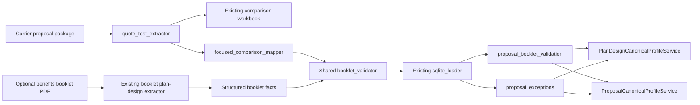

# Canonical Proposal Booklet Validation

Status: Implemented desktop pipeline stage

Applies to: Renewal Review Builder desktop WPF app only

## Purpose

This stage compares saved focused carrier proposal plan-design facts with structured current-plan facts extracted from an optional benefits booklet. It fills the existing proposal validation contract without changing the established carrier comparison workbook.

## Pipeline

## Canonical comparison rule

The validator first maps both sides to canonical benefit and provision codes. It compares structured fields such as coinsurance, maximum, frequency, waiting period, and termination age only when one unambiguous booklet value is available.

Results are:

- `MATCH` when normalized structured values agree
- `DIFFERENT` when comparable structured values disagree
- review issue when the booklet has multiple class values, no mapped field, no extracted value, unreadable text, or different free-text wording

The validator does not infer whether a proposal difference is better or worse.

## Evidence

Each persisted validation row keeps the proposal source evidence in the existing table columns. Its JSON payload also retains:

- booklet source file
- booklet page and section
- booklet class names
- booklet carrier
- booklet extraction confidence
- comparison method

## Persistence

This stage reuses:

- `proposal_plan_design`
- `proposal_booklet_validation`
- `proposal_exceptions`
- `proposal_files` reprocessing identity

No table, migration, database path, or duplicate repository was added. Reprocessing the same client, carrier, and source package replaces that proposal's detail and validation rows idempotently.

## Compatibility boundary

The comparison workbook is generated before canonical validation and remains unchanged. Booklet read or matching problems do not discard proposal extraction or persistence; they are saved as review issues and leave validation rows empty where evidence is insufficient.
