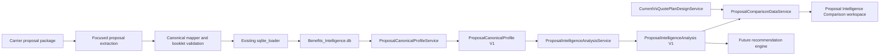

# Canonical Proposal Intelligence Analysis V1

Status: Implemented read-only desktop analysis layer

Applies to: Renewal Review Builder desktop WPF app only

## Purpose

`ProposalIntelligenceAnalysisService` turns `ProposalCanonicalProfile` into a stable, source-backed carrier analysis. It compares saved proposal versions across financial facts, plan design, booklet validation, underwriting assumptions, pooling, and retention without opening SQLite or selecting a recommended carrier.

The analysis is a read model. It does not extract files, persist data, calculate a renewal recommendation, update Reports, or change exports. The Proposal Comparison workspace consumes this read model through its presentation data service.

## Pipeline position

## Contract

The output is versioned as `PROPOSAL_INTELLIGENCE_ANALYSIS_V1` and includes:

- client and canonical profile identity
- every saved proposal version, including repeated versions from the same carrier
- proposal dates, source identity, confidence, readiness, and evidence
- monthly and annual proposal premium totals
- employer and employee cost totals where saved
- factual annual-premium deltas from the lowest saved proposal premium
- rate comparisons by benefit, class, tier, age band, gender, province, and rate basis
- premium comparisons by benefit, class, and tier
- plan-design comparisons by benefit and provision
- proposal-to-booklet mismatch status and both proposal-side and booklet-side evidence
- underwriting assumption comparisons
- pooling, retention, commission, target loss ratio, guarantees, and cap comparisons
- source-backed readiness and review findings

## Comparison rules

The analysis does not invent missing carrier values.

- A comparison is `Same` when every expected proposal has a usable value and the normalized saved values agree.
- A comparison is `Different` when every expected proposal has a usable value and at least one saved value differs.
- A comparison is `Incomplete` when one or more expected proposals do not have the required value.
- A comparison is `Not Comparable` when fewer than two usable proposal values exist.
- A plan-design comparison is `Needs Review` when saved booklet validation reports a mismatch.

Rate rows use `proposal_rates`, with proposal benefit-line rates as a fallback only when a proposal has no normalized rate rows. Premium rows use `proposal_premiums`, with proposal benefit-line premiums as a fallback only when no normalized premium rows exist.

The lowest saved annual premium is a factual baseline. It is not a carrier recommendation and does not account for coverage quality, underwriting terms, service, implementation risk, or consultant strategy.

## Readiness

| Status | Meaning |
|---|---|
| `Ready` | At least two proposals support carrier, financial, and plan-design comparison, and the canonical profile is ready |
| `Partial` | Usable proposal facts exist, but a comparison dimension or evidence is incomplete |
| `Needs Review` | Saved validation, booklet mismatch, or extraction evidence requires review |
| `Not Ready` | No usable saved proposal facts exist |

Readiness is descriptive. It does not approve a proposal or choose a finalist.

## Read-only boundary

The analysis service:

- depends on `ProposalCanonicalProfileService`
- offers `BuildAsync(clientId)` for saved data and `Build(profile)` for deterministic analysis and testing
- does not reference `DatabaseService` or `Microsoft.Data.Sqlite`
- does not call proposal or booklet runners
- does not call underwriting, quote, workbook, PowerPoint, or export engines
- adds no table, migration, repository, or database path
- preserves the source evidence already carried by the canonical profile

## Consumer rule

The dedicated Proposal Pipeline Overview remains the first migrated UI consumer of the canonical proposal profile. The Proposal Intelligence Comparison workspace is the first desktop consumer of this V1 analysis contract.

`ProposalComparisonDataService` maps the analysis contract into proposal, financial, carrier plan-design, underwriting, and review rows. It composes `CurrentVsQuotePlanDesignService` as a compatibility section so current-plan comparisons remain available while the carrier analysis uses the canonical proposal contract.

The workspace does not query proposal tables, rerun extraction, calculate recommendations, or replace the tuned comparison-workbook runner. Reports and exports remain separate consumers until their own parity migrations are complete.
