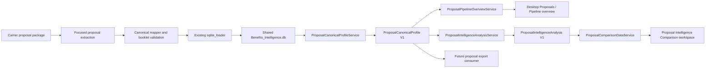

# Canonical Proposal Profile V1

Status: Implemented read-only desktop profile

Applies to: Renewal Review Builder desktop WPF app only

## Purpose

`ProposalCanonicalProfileService` gives downstream Proposal Intelligence workflows one stable, source-backed view of every saved proposal for one client or for all clients with saved proposals. It combines proposal identity, rates, premiums, plan design, booklet validation, underwriting facts, exceptions, and load lineage without creating another SQLite table family.

The profile is a read model. It does not extract documents, save proposal data, calculate recommendations, update dashboards, or alter exports.

## Pipeline position

## Existing tables reused

The profile reads the existing proposal table family:

- `Clients`
- `carriers`
- `proposal_files`
- `proposal_summary`
- `benefits`
- `proposal_benefit_lines`
- `proposal_rates`
- `proposal_premiums`
- `proposal_plan_design`
- `proposal_booklet_validation`
- `proposal_demographics`
- `proposal_underwriting_assumptions`
- `proposal_pooling_retention`
- `proposal_exceptions`
- `proposal_export_audit`

No table, migration, repository, or database path was added.

## Profile output

`ProposalCanonicalProfile` contains:

- stable profile version `PROPOSAL_CANONICAL_PROFILE_V1`
- selected desktop client identity
- all saved proposal versions for that client
- carrier and source-package identity per proposal
- proposal and effective dates
- normalized benefit definitions and benefit lines
- rates, premiums, employer cost, employee cost, and total cost
- plan-design provisions and proposal-to-booklet validation
- demographics and underwriting assumptions
- pooling, retention, commission, rate guarantees, and caps
- extraction and validation exceptions
- persistence audit lineage
- source file, hash, page, sheet, confidence, method, status, and raw payload evidence
- booklet-side file, page, section, class, carrier, and confidence evidence for validation rows
- proposal-level and profile-level readiness

## Proposal history

The profile does not collapse proposals by carrier. Each `proposal_id` and source package remains a separate proposal version, so multiple carriers and multiple versions from the same carrier can coexist in one client profile.

Client matching supports the current desktop numeric client id and the existing proposal storage keys that may contain a client name or client number.

## Readiness

| Status | Meaning |
|---|---|
| `Ready` | Core proposal facts, financial facts, plan design, validation, and source evidence are present with no review issue |
| `Partial` | Usable proposal facts exist, but financial facts, plan design, validation, or evidence is incomplete |
| `Needs Review` | A booklet mismatch or saved extraction/validation exception requires review |
| `Not Ready` | No saved proposal or no usable normalized proposal facts were found |

The profile separately reports whether it can support Proposal Intelligence and whether at least two proposals can be compared by carrier, financial facts, or plan design.

## Read-only guarantee

The service:

- opens SQLite with `SqliteOpenMode.ReadOnly`
- applies `PRAGMA query_only = ON`
- treats missing detail tables as optional for older databases
- performs no initialization, migration, insert, update, or delete
- does not call `DatabaseService`, proposal runners, document parsers, workbook writers, or export services

Focused tests compare every table count before and after profile construction.

## Consumer rule

New Proposal Intelligence consumers should depend on `ProposalCanonicalProfileService` and `ProposalCanonicalProfile`. They should not assemble new proposal-domain reads directly from the normalized proposal tables.

The dedicated desktop Proposals / Pipeline overview is the first migrated consumer. `ProposalPipelineOverviewService` reads all saved canonical profiles, preserves every saved proposal version, and maps those facts into the existing nine-stage overview without opening SQLite itself.

`ProposalIntelligenceAnalysisService` is the first canonical proposal analysis layer. It compares financial, plan-design, validation, underwriting, pooling, and retention facts while preserving missing values and source evidence. It does not select a recommended carrier.

The Proposal Intelligence Comparison workspace is the second migrated proposal UI consumer. `ProposalComparisonDataService` maps the canonical analysis into the workspace and composes the existing Current vs Quote plan-design service without opening SQLite.

Stored workflow status takes priority. Canonical readiness may place incomplete proposals in pending or review stages and may recognize a comparison when multiple usable carriers are saved, but it does not infer presentation, finalist, or sold/lost stages without a saved status.

The broader Reports dashboard and proposal exports remain on their existing paths until each consumer is migrated and parity is verified. Current vs Quote remains available as a compatibility tab within the migrated Proposal Intelligence Comparison workspace.
