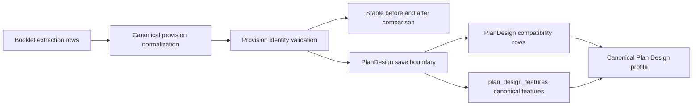

# Canonical Provision Identity and Row Shape V1

Status: Implemented desktop architecture standard

Applies to: Renewal Review Builder desktop WPF app only

Version: `CANONICAL_PROVISION_IDENTITY_V1`

## Purpose

Booklet extractors may produce one consolidated row per benefit or many detail rows that repeat a broad benefit name. This standard gives both shapes one shared canonical boundary before validation, comparison, or persistence.

It prevents three failures:

- a labeled multi-rate provision such as 80%, 90%, and 80% being treated as one ambiguous value
- repeated broad labels such as `Prescription Drugs` hiding the actual provisions
- before/after rows being paired by their displayed value and reported as false changes

## Canonical identity

Every Plan Design row has:

- a canonical benefit code
- a normalized class identity
- a stable provision code
- a human-readable provision label

The comparison identity is:

```text
canonical benefit code | normalized class | provision code
```

Values such as reimbursement, maximum, frequency, deductible, waiting period, and source text are not part of the identity. A changed value therefore remains attached to the same provision.

## Canonical row shape

One canonical row represents one named provision for one benefit and class.

The shared mapper may:

- split a multi-rate row only when every percentage is explicitly linked to a source label
- remove a derived cost-sharing row when the same benefit and class already has the source-backed coinsurance provision
- remove generic Dental Care rate or maximum summaries when equivalent Basic, Major, or Orthodontic rows already exist
- retain distinct provisions such as deductible, recall, eligibility, plan type, maximum, and termination

The mapper must not guess the meaning of unlabeled percentages. Missing or duplicate provision identities are blocking issues in controlled reprocessing.

## Required path



Both current database rows and newly extracted rows are normalized before controlled comparison. Direct booklet saves use the same normalizer before writing either Plan Design table.

## Persistence

No new SQLite tables or migrations are introduced.

- `PlanDesign` remains the compatibility fact table.
- `plan_design_features` remains the structured feature table.
- `feature_name` stores the canonical provision label.
- controlled run snapshots retain the transient provision code and label used for review and comparison.

Provision identity is derived deterministically from source-backed labels, so historical rows can enter the standard through controlled document reprocessing without a schema rewrite.

## Ownership

- `PlanDesignCanonicalMapper` owns row normalization and stable provision identity.
- `NormalizedDataValidator` owns missing and duplicate identity checks at the normalized contract.
- `DatabaseService.SavePlanDesignAsync` owns the canonical persistence boundary.
- `CanonicalControlledBookletReprocessingService` normalizes both sides, blocks identity collisions, and compares stable keys.
- WPF views display the resulting provision label and do not create or repair provision identity.

## Verification

Focused tests cover:

- explicitly labeled 80/90/80 rate splitting
- derived cost-sharing removal
- redundant Dental Care summary removal
- stable comparison identity when a value changes
- missing and duplicate identity validation
- canonical provision names in `plan_design_features`

The architecture test requires this standard to remain wired to the shared mapper, persistence boundary, validator, and controlled workflow.
