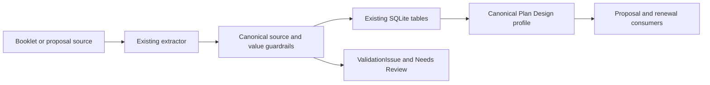

# Canonical Source Lineage and Value Guardrails V1

Labeled multi-rate dental wording is handled before persistence by `CANONICAL_LABELED_DENTAL_RATE_MAPPER_V1`. It emits separate source-backed provisions only when each percentage has an explicit nearby label; unlabeled or conflicting percentages remain review-only. See `canonical-labeled-dental-rates-v1.md`.

Status: Implemented desktop architecture standard

Applies to: Renewal Review Builder desktop WPF app only

Version: `CANONICAL_SOURCE_LINEAGE_VALUE_GUARDRAILS_V1`

## Purpose

This standard prevents a saved plan-design fact from silently claiming the wrong source document or exposing an unsafe reimbursement percentage. It hardens the existing canonical pipeline before a real proposal is imported.

V1 is additive. It reuses `Documents`, `ImportBatch`, `ValidationIssue`, `PlanDesign`, and `plan_design_features`. No new SQLite tables or migrations are introduced.

## Pipeline position

## Source lineage contract

1. `source_document_id` is the durable link to the source document.
2. When that link exists, `Documents.file_name` is the canonical filename.
3. A copied `source_file_name` is corroborating metadata, not an independent source of truth.
4. If the copied filename conflicts with the linked document filename, the linked filename is exposed and the fact is marked `Needs Review` with issue code `source_lineage_conflict`.
5. A multi-document booklet save starts and completes import tracking separately for each source document. Only rows mapped to that document receive its filename, import batch, confidence, and extraction metadata.
6. A filename without a document link is preserved as `Unlinked`; it is not silently represented as verified lineage. Current-plan facts in this state require review, while proposal facts may use their proposal-file hash evidence without a `Documents` link.
7. Missing source evidence remains missing and must not be invented from another file in the import.

## Percentage value contract

| Source shape | Canonical behavior |
|---|---|
| One percentage from 0 through 100 | Store and expose the numeric percentage as `Valid` |
| A simple decimal string from greater than 0 through 1 | Normalize to percent form during booklet parsing, such as `0.8` to `80` |
| More than one distinct percentage | Do not invent one numeric value; preserve the original wording and mark `Preserved for Review` |
| A numeric value below 0 or above 100 | Reject the numeric value, preserve available source wording, and mark `Rejected` |
| No percentage supplied | Keep the numeric value null and mark `Not Applicable` |

Review issue codes are:

- `source_lineage_conflict`
- `source_lineage_unlinked`
- `plan_design_percentage_out_of_range`
- `plan_design_multiple_percentages_preserved`

Tiered wording remains available in `plan_design_features.coinsurance`, `feature_value`, or source text. V1 does not flatten a tiered benefit into a single reimbursement percentage.

## Canonical profile behavior

`PlanDesignCanonicalProfileService` remains read-only. Each fact now carries:

- guardrail version
- resolved canonical source filename
- originally tracked source filename
- source lineage status and message
- value guardrail status and message
- the existing evidence, import batch, confidence, page, sheet, and raw source reference

A lineage conflict, rejected percentage, or preserved multi-percentage value makes the fact and profile `Needs Review`. Missing quote data continues to produce `Partial` when no guardrail issue exists.

## Persistence behavior

The existing `DatabaseService.SavePlanDesignAsync` path remains the writer. For multi-document imports it now:

1. resolves every row to its own document
2. opens one import batch per used document
3. writes guarded numeric percentages only
4. preserves tiered percentage text in the existing feature row
5. validates and completes each document batch using only that document's rows
6. retains idempotent reprocessing by deleting and rebuilding rows for the same source documents

## Compatibility boundary

V1 does not change:

- `BookletExtractorRunner`
- proposal extraction or carrier-specific parser behavior
- proposal comparison formulas
- workbook generation
- PowerPoint generation
- existing SQLite table definitions
- existing export services

Historical rows are not rewritten automatically. A controlled reprocess of the authoritative source documents is required to repair previously stored lineage or percentage errors.

## Acceptance checks

V1 is accepted only when:

- two documents saved in one run retain different document ids and import batch ids
- every saved copied filename matches its linked `Documents.file_name`
- repeated import keeps plan-design row counts stable
- tiered percentage wording survives while the numeric field remains null
- out-of-range values are not exposed by the canonical profile
- conflicts create review issues and `Needs Review` readiness
- profile construction remains read-only
- the desktop app and focused regression suite build and pass
