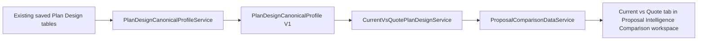

# Current vs Quote Plan Design

Status: Implemented canonical desktop consumer

Applies to: Renewal Review Builder desktop WPF app only

## Purpose

Current vs Quote is the first downstream workflow migrated to the canonical Plan Design profile. It compares saved current-plan provisions with saved proposal plan-design provisions without querying source tables from the UI.

## Data path

## Responsibilities

`CurrentVsQuotePlanDesignService`:

- matches current and quote facts by the canonical comparison key
- keeps each saved proposal as a distinct quote
- preserves source evidence and validation status
- marks missing values instead of filling them
- reports `Same`, `Different`, `Current Only`, `Quote Only`, `Needs Review`, or `Unavailable`
- does not rank a changed provision as better or worse

`ProposalComparisonDataService`:

- converts both the canonical proposal analysis and Current vs Quote comparison contracts into display rows
- formats evidence summaries for the desktop workspace
- does not open SQLite or execute business extraction

The WPF workspace:

- receives the selected client id from `MainWindow`
- displays proposal summaries, financial comparisons, carrier plan design, underwriting, findings, and current-versus-quote facts
- keeps current and saved quote facts dynamic for any carrier in a dedicated compatibility tab
- exposes validation and missing-data issues
- does not contain carrier-specific columns, mock proposal values, SQL, or parser logic

## Existing behavior left unchanged

This migration does not change:

- `PlanDesign`, `plan_design_features`, `proposal_plan_design`, or `proposal_booklet_validation`
- database initialization or migrations
- booklet extraction
- carrier proposal extraction
- proposal workbook generation
- Excel or PowerPoint exports

## Focused comparison runner

The focused carrier comparison runner continues to use `proposal_engine.quote_test_extractor` and still builds the established comparison workbook first. It now maps each carrier result through `focused_comparison_mapper.py` and saves the normalized proposal facts through the existing `sqlite_loader.py` persistence layer.

The selected desktop client id, client name, and shared database path are passed to the runner. After a successful save, the Current vs Quote workspace refreshes from `PlanDesignCanonicalProfileService` and displays the newly saved quote facts.

When the user supplies an optional benefits booklet, the focused workflow validates canonical proposal provisions against structured booklet facts before persistence. Defensible results are saved to `proposal_booklet_validation`; ambiguous or unmapped comparisons remain review issues in `proposal_exceptions`. Without a booklet, the validation table remains empty for that proposal.

## Verification

Focused tests cover:

- equivalent current and quote values
- neutral difference detection
- missing values on either side
- multiple saved proposals
- failed proposal validation
- current-only profiles
- canonical proposal-analysis mapping alongside unchanged Current vs Quote rows
- the six-tab Proposal Intelligence Comparison workspace in its empty-client state
- the no-direct-SQLite consumer boundary
