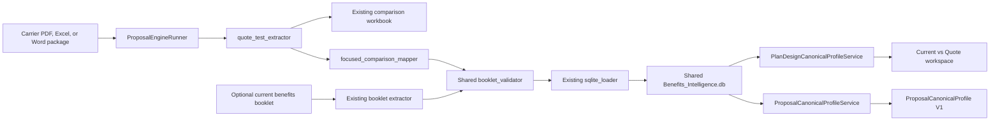

# Focused Proposal Canonical Persistence

Status: Implemented desktop pipeline stage

Applies to: Renewal Review Builder desktop WPF app only

## Purpose

The focused multi-carrier proposal workflow now preserves its existing workbook output and also saves normalized quote facts into the shared desktop SQLite database. This closes the durable-storage gap between carrier extraction and the Current vs Quote canonical profile.

## Pipeline

## Mapper responsibility

`focused_comparison_mapper.py` converts the extractor's workbook-shaped model into the existing normalized proposal persistence contract. It:

- creates one proposal record per detected carrier or carrier option
- keeps benefit lines, rates, premiums, demographics, plan design, rate guarantees, exceptions, and source evidence separated
- uses the selected desktop client identity when available
- preserves each row's source file, page or location, confidence, and status
- does not open SQLite
- does not create another proposal model or table family

## Existing tables reused

The existing `sqlite_loader.py` remains the proposal persistence owner. The focused workflow reuses:

- `carriers`
- `proposal_files`
- `proposal_summary`
- `benefits`
- `proposal_benefit_lines`
- `proposal_rates`
- `proposal_premiums`
- `proposal_plan_design`
- `proposal_demographics`
- `proposal_underwriting_assumptions`
- `proposal_pooling_retention`
- `proposal_booklet_validation`
- `proposal_exceptions`
- `proposal_export_audit`

No new SQLite table was added.

## Desktop client protection

SQLite treats `Clients` and `clients` as the same name. The legacy proposal loader previously assumed it owned a separate lowercase `clients` table with an `id` column.

The loader now detects the desktop core `Clients` schema, resolves the selected client without adding proposal columns, and leaves the core client row and schema unchanged. A legacy standalone proposal database remains supported when it already owns the older proposal-style `clients` table.

## Reprocessing and history

Proposal identity is scoped by:

- client id
- carrier id
- source package hash

Running the same carrier package again refreshes the same proposal and replaces only that proposal's detail rows. It increments `reprocess_count` and does not create duplicates.

A changed source package receives a new hash and remains a separate historical proposal version.

## Validation behavior

When a current benefits booklet is supplied, the focused workflow now reuses the established structured booklet extractor and shared `booklet_validator.py`. The validator maps booklet fields and proposal provisions to canonical benefit and provision codes before comparing them.

`proposal_booklet_validation` receives only defensible comparisons:

- one unambiguous structured booklet value produces `MATCH` or `DIFFERENT`
- multiple class values, missing mappings, unreadable booklets, and unmatched provisions produce `proposal_exceptions` review items
- free-text wording differences require review and are not stored as proven differences
- proposal and booklet source evidence is retained in each validation payload

No validation row is fabricated when evidence is incomplete.

## Verification

Automated tests prove:

- multi-carrier results split into separate proposals
- the existing normalized proposal contract is used
- repeated processing is idempotent
- two carriers can share one source package without colliding
- core desktop `Clients` columns and rows remain unchanged
- row-level source evidence is retained
- validation rows are not fabricated
- semantic percentage matches and genuine structured differences are distinguished
- ambiguous class-level booklet values remain review issues
- validation reprocessing replaces the same proposal detail rows without duplication
