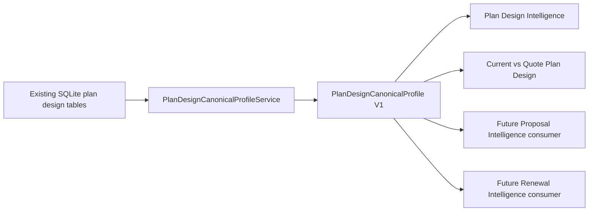

# Canonical Plan Design Profile

Dental current-plan facts use the shared canonical provision vocabulary from `CANONICAL_LABELED_DENTAL_RATE_MAPPER_V1`. This lets booklet labels such as `Dental Basic Services`, `Basic Restorative`, and proposal label `Basic` share one comparison key without combining their values with Major or Orthodontic rates.

Status: Implemented read-only desktop profile V1

Applies to: Renewal Review Builder desktop WPF app only

## Purpose

The canonical Plan Design profile gives every downstream workflow one stable view of saved plan design data. It combines current plan facts, quote facts, proposal-to-booklet validation, source evidence, plan design factor references, and related benefit lines without creating another SQLite table.

The profile is a read model. It does not extract documents, save data, calculate premiums, or change existing reports.

## Pipeline position

## Canonical inputs

| Existing source | Canonical use |
|---|---|
| `PlanDesign` | Current benefit-level plan facts |
| `plan_design_features` | Current provision-level plan facts |
| `proposal_plan_design` | Quote plan facts |
| `proposal_booklet_validation` | Proposal-to-current-plan validation facts |
| `plan_design_factors` | Read-only pricing factor references |
| `Renewals`, `Rates`, `ClaimsExperience`, `MonthlyClaims`, `claims_distribution` | Benefit-line context used to identify missing plan facts |
| `Clients`, `Documents` | Client identity and source evidence |

No source table is replaced or rewritten by the profile.

## Canonical output

`PlanDesignCanonicalProfile` contains:

- stable profile version `PLAN_DESIGN_CANONICAL_PROFILE_V1`
- client identity and carrier
- current plan, quote, and validation facts separated by scope
- canonical benefit code and normalized benefit key
- stable comparison key for matching Current Plan to Quote provisions
- source document, page, sheet, file hash, confidence, extraction method, and import lineage when available
- canonical source filename resolution plus the originally tracked filename, lineage status, and lineage message
- guarded reimbursement values with explicit valid, rejected, or preserved-for-review status
- profile issues for missing current data, missing quotes, missing validation, unmapped benefits, and proposal mismatches
- plan design factor references and related benefit-line context
- readiness capabilities for Current vs Quote, Proposal Intelligence, Renewal Intelligence, and Plan Design Intelligence

## Readiness meaning

| Status | Meaning |
|---|---|
| `Ready` | Current plan, quote, and proposal validation facts are available with no blocking issue |
| `Partial` | Current plan is usable, but quote, validation, mapping, or confidence information is incomplete |
| `Needs Review` | A proposal mismatch, unverified current-plan lineage, source-lineage conflict, rejected percentage, or preserved multi-percentage value requires human review |
| `Not Ready` | No current plan facts are available |

## Read-only guarantee

The profile reuses the existing Plan Design Intelligence read-only SQLite connection:

- SQLite opens in read-only mode
- `PRAGMA query_only = ON` is applied
- no migration or table creation runs
- no rows are inserted, updated, or deleted
- existing Plan Design Intelligence output is built from the same canonical profile path

Focused tests compare every table count before and after profile construction.

## Consumer rule

New Plan Design consumers should depend on `PlanDesignCanonicalProfileService` and `PlanDesignCanonicalProfile`. They should not query `PlanDesign`, `plan_design_features`, `proposal_plan_design`, or `proposal_booklet_validation` directly.

Existing focused extraction rules and workbook generation remain unchanged. Focused carrier results now map into the existing proposal persistence contract, and an optional booklet is validated through the shared structured booklet path before this profile reads the saved facts. `CurrentVsQuotePlanDesignService` is the first migrated comparison consumer, and `ProposalComparisonDataService` maps the result for the WPF workspace without opening SQLite.

All plan-design facts pass through `CANONICAL_SOURCE_LINEAGE_VALUE_GUARDRAILS_V1`. The linked `Documents.file_name` is authoritative when a document id exists. Unsafe numeric percentages are removed from canonical output, while the original wording remains available as evidence and a review issue. The guardrail does not create or write a new profile table.

Proposal Intelligence and Renewal Intelligence remain the next consumer migrations.
