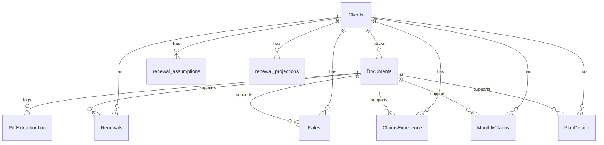

# Benefits Intelligence Database

The desktop Benefits Intelligence Platform now has a SQLite foundation called `Benefits_Intelligence.db`.

## Location

The database is created automatically in the existing desktop app data folder:

`%LOCALAPPDATA%\Westland\RenewalReviewBuilder\data\Benefits_Intelligence.db`

This keeps it out of the project folder and avoids OneDrive file-lock issues during normal use.

## Core Tables

```sql
Clients(
  client_id primary key,
  client_name unique,
  client_number unique when present,
  carrier,
  industry,
  province,
  advisor,
  effective_date,
  renewal_month,
  status,
  date_created,
  date_updated
)

Documents(
  document_id primary key,
  client_id references Clients,
  document_type,
  module_name,
  file_name,
  file_type,
  file_path,
  file_hash unique,
  carrier,
  effective_date,
  period_start,
  period_end,
  upload_date,
  processed_date,
  processing_status
)

PdfExtractionLog(
  log_id primary key,
  document_id references Documents,
  extraction_method,
  confidence_score,
  fallback_reason,
  page_count,
  table_count,
  processing_time,
  error_message,
  manual_review_required,
  date_processed
)

Renewals(
  renewal_id primary key,
  client_id references Clients,
  renewal_year,
  carrier,
  benefit_line,
  current_rate,
  renewal_rate,
  rate_change_percent,
  premium,
  claims,
  loss_ratio,
  lives,
  renewal_status,
  source_document_id references Documents,
  date_loaded
)

Rates(
  rate_id primary key,
  client_id references Clients,
  carrier,
  benefit_line,
  class,
  current_rate,
  proposed_rate,
  negotiated_rate,
  rate_basis,
  effective_date,
  source_document_id references Documents,
  date_loaded
)

renewal_assumptions(
  assumption_id primary key,
  client_id references Clients,
  carrier,
  benefit_line,
  trend,
  target_loss_ratio,
  pooling_charge,
  pooling_threshold,
  ibnr,
  admin_fee,
  risk_charge,
  effective_date
)

renewal_projections(
  projection_id primary key,
  client_id references Clients,
  benefit_line,
  current_premium,
  projected_claims,
  trend_adjustment,
  required_premium,
  proposed_premium,
  negotiated_premium,
  renewal_change_percent,
  savings
)

ClaimsExperience(
  claims_id primary key,
  client_id references Clients,
  experience_period_start,
  experience_period_end,
  benefit_line,
  premium,
  paid_claims,
  incurred_claims,
  loss_ratio,
  lives,
  source_document_id references Documents,
  date_loaded
)

MonthlyClaims(
  claim_month_id primary key,
  client_id references Clients,
  carrier,
  benefit_line,
  month,
  lives,
  premium,
  paid_claims,
  incurred_claims,
  claims_plus_fees,
  loss_ratio,
  source_document_id references Documents,
  date_loaded
)

PlanDesign(
  plan_design_id primary key,
  client_id references Clients,
  benefit_category,
  benefit_name,
  coverage_description,
  reimbursement_percent,
  maximum_amount,
  frequency,
  waiting_period,
  termination_age,
  source_document_id references Documents,
  source_page,
  date_loaded
)

Carrier(
  carrier_id primary key,
  carrier_code unique,
  carrier_name unique,
  commission_statement_format,
  bonus_program_version,
  has_rate_guarantees,
  has_persistency_bonus,
  has_sales_bonus,
  has_growth_bonus,
  supports_billing_import,
  supports_claims_import,
  is_active,
  created_date,
  modified_date
)

BonusProgram(
  BonusProgramID primary key,
  CarrierID references Carrier(carrier_id),
  ProgramName,
  ProgramYear,
  QualificationStartDate,
  QualificationEndDate,
  PaymentFrequency,
  HasSalesBonus,
  HasPersistencyBonus,
  HasGrowthBonus,
  HasRetentionBonus,
  HasEliteBonus,
  HasSalesEnhancement,
  HasRateGuaranteeImpact,
  SourceDocument,
  Notes,
  IsActive,
  CreatedDate,
  ModifiedDate
)
```

## ER Diagram



## Module Connections

- Renewal Intelligence saves the client, renewal PDF document, PDF extraction log, renewal summary rows, and detailed rate rows after validation.
- Renewal assumptions are stored through `DatabaseService` for each client, carrier, benefit line, and effective date. The current PDF extractor does not automatically populate these values yet.
- Renewal projections are stored through `DatabaseService` for each client and benefit line. The current PDF extractor does not automatically populate full projection values yet.
- Claims Experience Intelligence saves the client, source documents, PDF extraction logs, EHC/Dental claims summaries, and monthly claims after the claims data model is exported.
- Benefit Booklet Intelligence saves the client, booklet PDF documents, extraction logs, and plan design rows when the booklet master workbook contains plan design columns.
- Proposal Comparison Intelligence now has a reusable Python proposal engine that writes normalized proposal data to `database\benefits_intelligence.db`. It creates proposal tables for files, summaries, benefit lines, rates, premiums, plan design, demographics, underwriting assumptions, pooling/retention, booklet validation, exceptions, and load audit rows.
- Commission Intelligence starts with the shared `Carrier` master table. Billing, Claims, Renewal, Document Operations, parser selection, bonus calculations, and rate guarantee logic can reference the same active carrier rows instead of hard-coding carrier names.
- Commission Intelligence bonus program setup stores one `BonusProgram` row per seeded carrier and program year. The table is configuration only; it does not calculate commissions or parse statement files.
- Carrier Intelligence and Underwriting Intelligence dashboard expansion remain separate from this proposal comparison engine.

## Duplicate Protection

- Clients match first by `client_number`, then by `client_name`.
- `client_name` is unique.
- `client_number` is unique when present.
- `province`, `advisor`, and `renewal_month` are client profile fields for renewal pipeline reporting.
- Documents use a SHA-256 `file_hash`; the same file is marked `reprocessed` instead of creating a duplicate document row.
- `file_type`, `period_start`, `period_end`, and `upload_date` make `Documents` serve the same purpose as a `source_files` table without creating duplicate storage.
- Rates are refreshed by `source_document_id` when a renewal document is reprocessed, so old rate rows from the same file do not pile up.
- Renewal assumptions are unique by `client_id`, `carrier`, `benefit_line`, and `effective_date`; saving the same assumption again updates the row.
- Renewal projections are unique by `client_id` and `benefit_line`; saving the same projection again updates the row.
- Carrier master rows are unique by `carrier_code` and `carrier_name`; deactivation keeps the record and changes `is_active` instead of deleting carrier history.
- Bonus program seed rows are matched by `CarrierID` and `ProgramYear`; deactivation keeps the record and changes `IsActive` instead of deleting program history.

## Backup

Close the desktop app, then copy this file:

`%LOCALAPPDATA%\Westland\RenewalReviewBuilder\data\Benefits_Intelligence.db`

Recommended backup name:

`Benefits_Intelligence_yyyyMMdd.db`

## Future SQL Server or Azure SQL Migration

Keep the desktop app calling `DatabaseService` instead of writing SQL in other modules. When the repository is ready for SQL Server or Azure SQL, replace the SQLite connection layer behind `DatabaseService`, keep the module calls the same, and migrate tables in this order: `Clients`, `Documents`, `PdfExtractionLog`, `Renewals`, `Rates`, `renewal_assumptions`, `renewal_projections`, `ClaimsExperience`, `MonthlyClaims`, `PlanDesign`.
